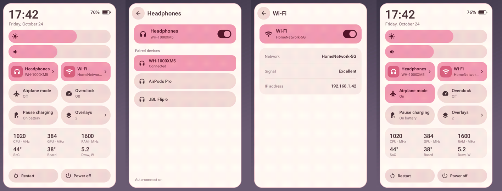

# quick-settings

Android-style quick settings for a modded Nintendo Switch (Atmosphère). Swipe
in from the left or right edge of the screen, in any game or in the HOME menu,
and a panel slides out on that side: headphones, Wi-Fi, airplane mode,
overclock, brightness, volume.



*Rendered by the host preview (`host/build.sh`), which runs the same UI code.*

It is a Tesla-style overlay: it replaces Tesla Menu / Ultrahand as the
overlay that nx-ovlloader starts, and can still launch your other overlays.

## What it does

- **Headphones** and **Wi-Fi** are split tiles, like on a Pixel: tap the icon
  to turn them on or off, tap the rest of the tile for details (paired
  Bluetooth audio devices; network, signal and IP address).
- **Airplane mode** turns Wi-Fi and Bluetooth off and stays on while you turn
  either back on, like the system's own. Handheld only: in the dock it would
  cut off wireless controllers.
- **Overclock** asks sys-clk for the fastest stock clocks (CPU 1785 MHz,
  GPU 921 MHz, RAM 1600 MHz; sys-clk caps the GPU lower in handheld mode).
  Tap again to go back to normal. Not kept across reboots.
- **Pause charging** stops charging the battery while plugged in.
- **Overlays** launches your other Tesla overlays.
- Brightness and volume sliders (volume of whatever is playing the sound:
  speaker, wired or Bluetooth headphones, TV), clock, battery, and a sensor
  card from sys-clk (clocks, SoC/board temperature, power draw).
- Restart and power off (tap twice).

Tiles animate like Android's: off tiles are pills and turn into rounded
squares when on, a press spreads a ripple and pushes the neighboring tile
aside, and it bounces back on release.

| | |
|---|---|
| Open | swipe in from the left or right screen edge, or the Tesla combo (default `L + D-pad down + right stick`, read from `sdmc:/config/tesla/config.ini`) |
| Close | swipe the panel back to its edge, tap outside it, `B`, the combo, HOME |
| Buttons | D-pad moves focus, `A` toggles, `X` opens details, left/right moves a slider |

## Status

Tested on one console with HOS 21.1.0 and Atmosphère. It changes console
settings (Wi-Fi, Bluetooth radio, charging, clocks), so treat it as early
software. Bug reports with the log (below) are welcome.

## Install

1. Back up `sd:/switch/.overlays/ovlmenu.ovl` if you have one (that file is
   Tesla Menu or Ultrahand; this panel takes its place).
2. Extract `quick-settings-<version>.zip` from
   [Releases](../../releases) to the SD card root and reboot.

The zip contains:

| SD path | What |
|---|---|
| `switch/.overlays/ovlmenu.ovl` | this panel |
| `atmosphere/contents/420000000007E51A`, `…7E51B` | [nx-ovlloader](https://github.com/ppkantorski/nx-ovlloader) v2.0.2 (starts overlays) |
| `atmosphere/contents/00FF0000636C6BFF`, `switch/.overlays/sys-clk-overlay.ovl` | [sys-clk](https://github.com/retronx-team/sys-clk) 2.0.1-21fix (overclock and sensors) |

If you already run nx-ovlloader and sys-clk, copying just `ovlmenu.ovl` is
enough. Without sys-clk the Overclock tile and the sensor card are disabled.

To uninstall, put your old `ovlmenu.ovl` back.

### Optional: headphone auto-connect

[bt-autoconnect](https://github.com/VelizarSeleznev/switch-bt-autoconnect) is
a small sysmodule that reconnects your Bluetooth headphones when the Switch
boots or wakes. With it installed, turning headphones off in this panel also
pauses auto-connect until you turn them on here (or connect them in System
Settings) again.

## Notes

- While another overlay is open, the swipe does nothing until you exit it
  (Tesla Menu behaves the same way).
- Airplane mode is remembered in `sdmc:/config/quick-settings/airplane`.
- The panel's edge (left or right) is remembered for overlays you launch from it.
- Log: `sdmc:/config/quick-settings/log.txt`.

## Building

```sh
host/build.sh [background.jpg]   # host preview: PNGs in host/out/ + UI checks, no Switch needed
scripts/build.sh                 # Docker devkitpro/devkita64 -> dist/sd/ and dist/quick-settings-<version>.zip
scripts/deploy.py <ip> [--ovl]   # upload dist/sd (or just the .ovl) over FTP (Sphaira)
scripts/deploy.py <ip> --log     # print the log
```

- `source/ui.cpp`: layout, drawing, touch and button handling, animation.
  Platform-independent; `host/preview.cpp` runs it against a fake console.
- `source/gfx.cpp`: software renderer for the 448x720 RGBA4444 layer
  (anti-aliased rounded shapes, stb_truetype text, ordered dithering).
- `source/main.cpp`: vi layer, input thread (edge swipe, combo, HOME/power),
  frame loop. Layer and focus handling follow libtesla.
- `source/sys_switch.cpp`: btm:sys, nifm, psm, lbl, audctl, apm, setsys, sys-clk IPC, spsm.
- `source/fonts_data.inc`: generated by `tools/make_fonts.py` (Roboto Flex
  and Material Symbols Rounded subsets; licenses in `fonts/`).

## License

GPL-2.0 (layer and focus code follows libtesla). Bundled: sys-clk client
(Beerware, `third_party/sysclk`), stb (public domain), Roboto Flex (OFL),
Material Symbols (Apache 2.0). The release zip also carries nx-ovlloader
(GPL-2.0) and sys-clk (Beerware) builds from their own releases.
